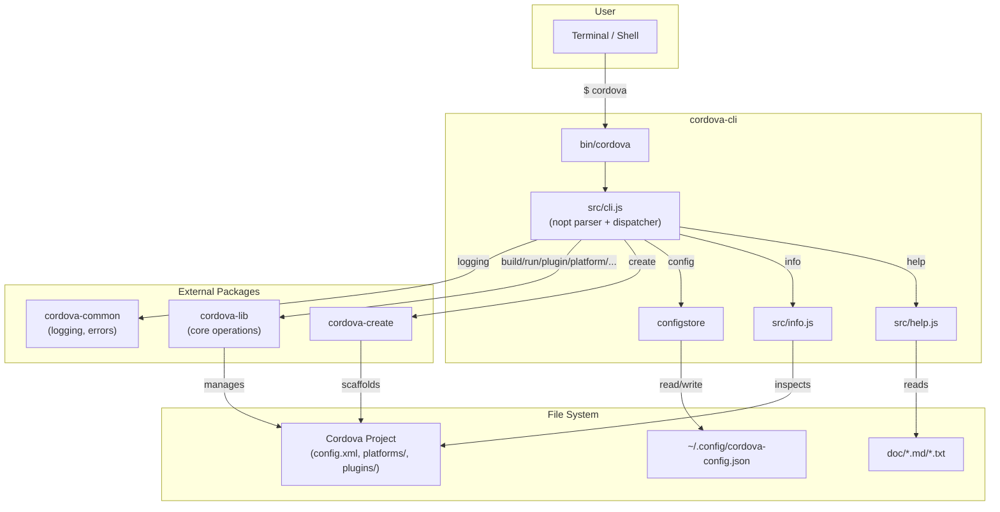
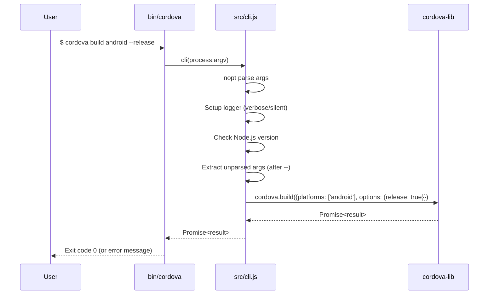
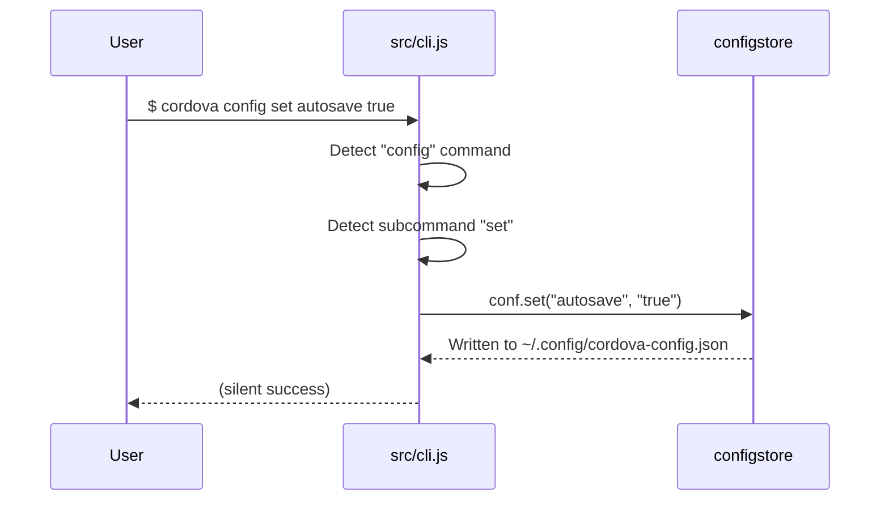
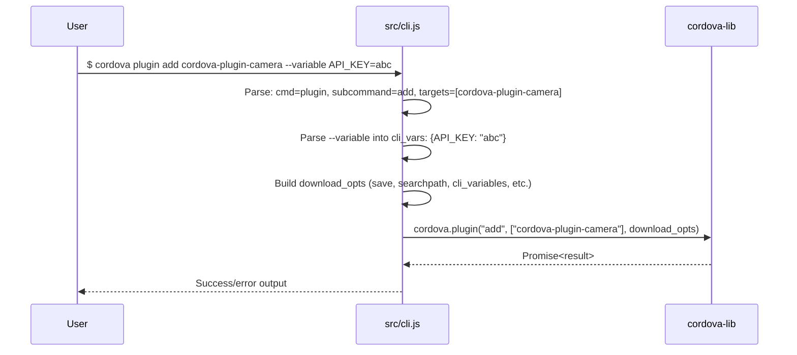
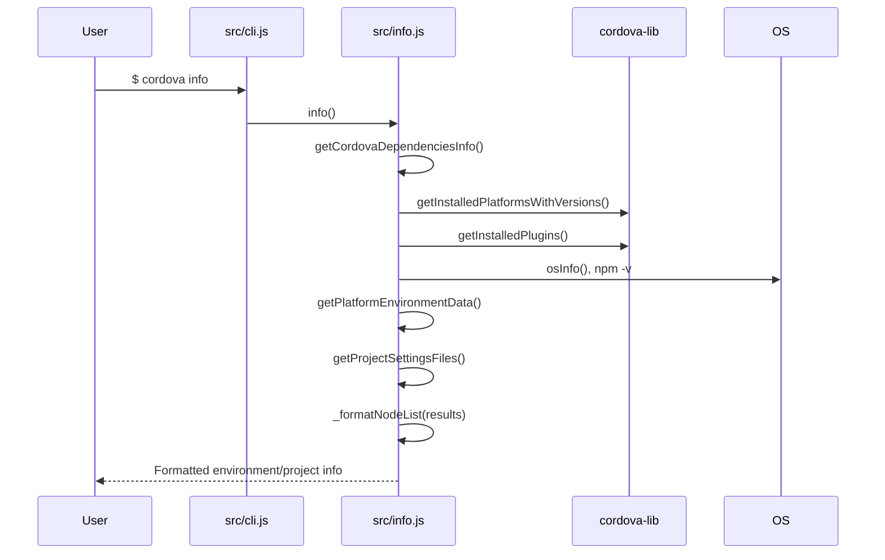

# Data Flow Diagrams

## System Architecture

## Command Execution Flow

## Config Command Flow

## Plugin/Platform Management Flow

## Info Command Flow

## Feature Dataflows

Individual dataflow diagrams for each feature are in `.ai/specs/dataflows/`:

| Feature | Dataflow File | Status |
|---------|--------------|--------|
| Command Dispatch | [dataflows/command-dispatch.md](dataflows/command-dispatch.md) | Complete |
| Config Management | [dataflows/config-management.md](dataflows/config-management.md) | Complete |
| Plugin Management | [dataflows/plugin-management.md](dataflows/plugin-management.md) | Complete |
| Platform Operations | [dataflows/platform-operations.md](dataflows/platform-operations.md) | Complete |
| System Info | [dataflows/system-info.md](dataflows/system-info.md) | Complete |
