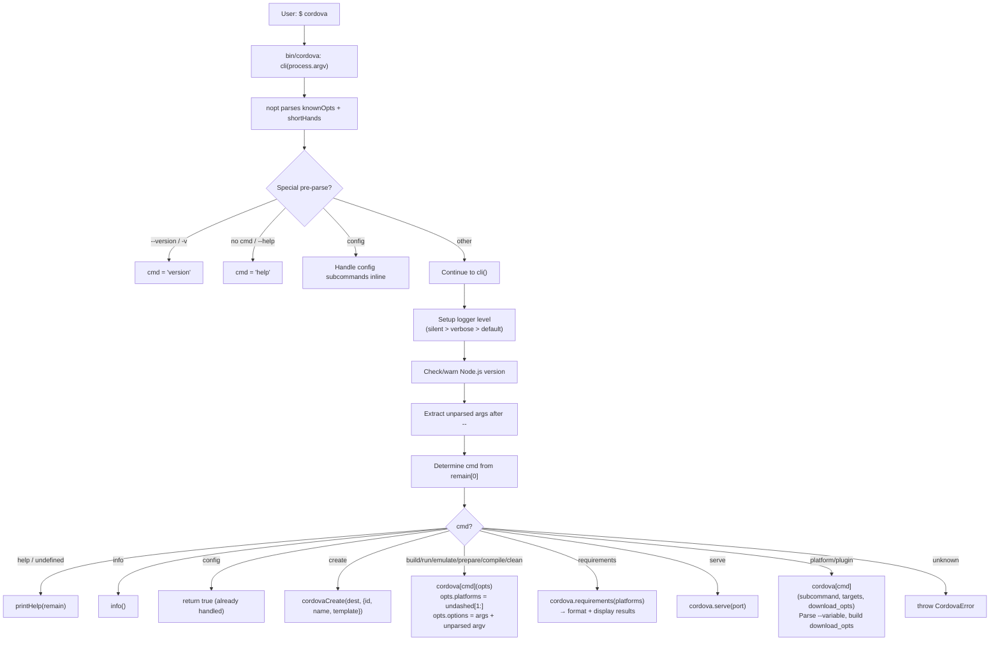

# Command Dispatch Dataflow

## Overview

The central routing logic in `src/cli.js` that parses CLI arguments and dispatches to the appropriate handler.

## Flow

## Key Source

- **Entry**: `bin/cordova` (lines 26-40)
- **Dispatcher**: `src/cli.js` (lines 77-350)
- **Arg parsing**: nopt with `knownOpts` (lines 40-68) and `shortHands` (lines 70-75)
