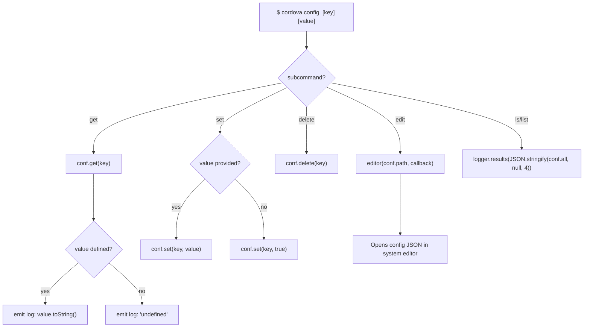

# Config Management Dataflow

## Overview

The `cordova config` command provides CRUD operations on persistent user configuration stored via the `configstore` package.

## Flow

## Storage

- **Package**: `configstore` (stores as `cordova-config`)
- **Location**: `~/.config/configstore/cordova-config.json`
- **Affects**: `searchpath` and `save-exact` are read from config as defaults when not passed via CLI flags

## Key Source

- `src/cli.js` lines 91-131 (config subcommand handling)
- `src/cli.js` lines 327-334 (config values used as defaults in plugin/platform ops)
