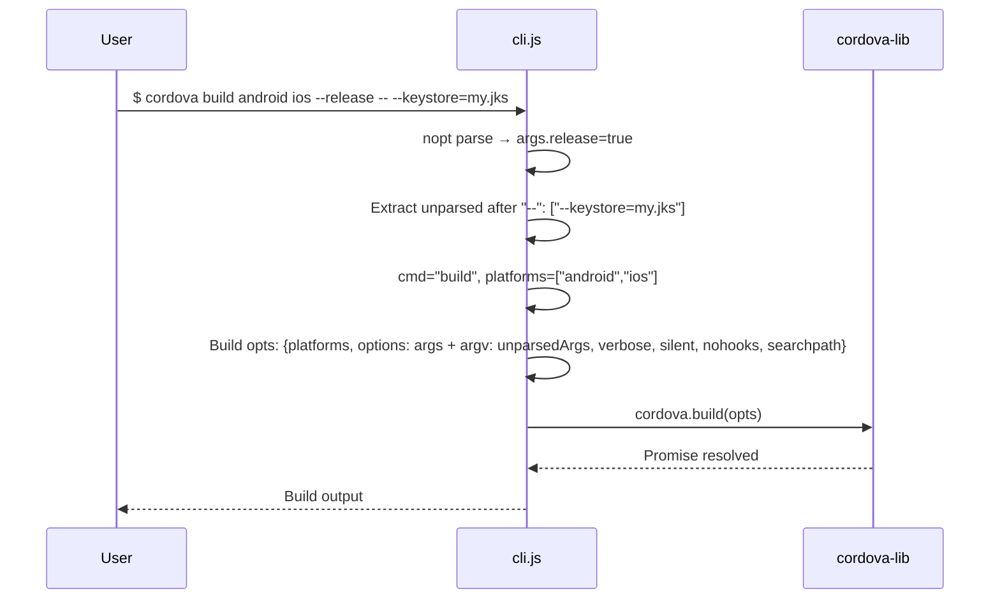

# Platform Operations Dataflow

## Overview

Platform commands (`build`, `run`, `emulate`, `prepare`, `compile`, `clean`) invoke the corresponding `cordova-lib` method with platform targets and pass-through options.

## Flow



## opts Schema for Platform Commands

```javascript
{
    platforms: ['android', 'ios'],   // undashed args after command
    options: {
        // All nopt-parsed flags (debug, release, device, emulator, target, etc.)
        argv: ['--keystore=my.jks']  // Unparsed args after "--"
    },
    verbose: false,
    silent: false,
    nohooks: [],
    searchpath: undefined
}
```

## Platform Entity Management

`cordova platform add/remove/ls` follows the same entity management pattern as plugins (see plugin-management.md), using `download_opts`.

## Key Source

- `src/cli.js` lines 253-262 (platform command dispatch)
- `src/cli.js` lines 263-301 (requirements command with result formatting)
