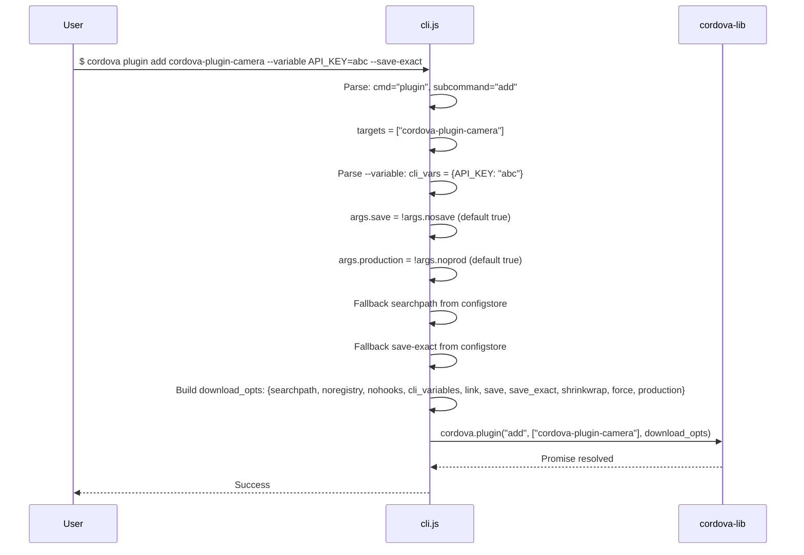

# Plugin Management Dataflow

## Overview

The `cordova plugin` command manages native plugins in a Cordova project, supporting add/remove/ls with variables, hooks suppression, and save behavior.

## Flow

## download_opts Schema

| Field | Source | Default |
|-------|--------|---------|
| searchpath | `--searchpath` flag or configstore | undefined |
| noregistry | `--noregistry` flag | false |
| nohooks | `--nohooks` flag (array) | [] |
| cli_variables | `--variable KEY=VAL` (parsed) | {} |
| link | `--link` flag | false |
| save | `!--nosave` | true |
| save_exact | `--save-exact` flag or configstore | false |
| shrinkwrap | `--shrinkwrap` flag | false |
| force | `--force` flag | false |
| production | `!--noprod` | true |

## Key Source

- `src/cli.js` lines 306-348 (plugin/platform entity command handling)
- Variable parsing: lines 309-322
