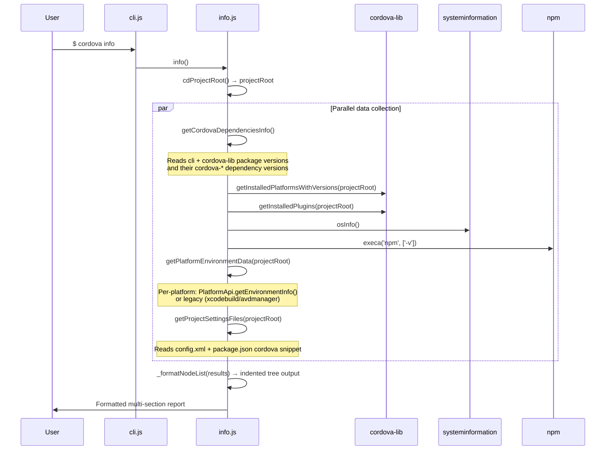

# System Info Dataflow

## Overview

`cordova info` collects and displays comprehensive environment and project diagnostics via `src/info.js`.

## Flow

## Output Sections

1. **Cordova Packages** — cli version → lib version → cordova-* dependency versions
2. **Project Installed Platforms** — platform name → version
3. **Project Installed Plugins** — plugin id → version
4. **Environment** — OS, Node.js, npm versions
5. **{Platform} Environment** — Platform-specific toolchain info (xcodebuild, android SDK)
6. **Project Setting Files** — config.xml contents, package.json cordova snippet

## Key Source

- `src/info.js` (full file, 225 lines)
- Data collectors: lines 34-132
- Formatter: `_formatNodeList` lines 183-208
- Orchestrator: lines 210-224
